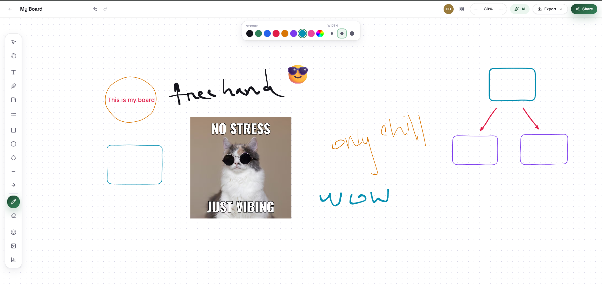

# Kagoj: AI Whiteboard

A real-time collaborative whiteboard with AI-assisted brainstorming. Users create boards, invite teammates, and sketch ideas together with live cursors and instant updates. Gemini can generate sticky notes, outlines, flow diagrams, charts, and summaries directly on the board.



## Features

- **Real-time collaboration:** Socket.IO updates for element changes, live element previews, cursors, and presence
- **Board management:** create, open, update, and delete boards; invite members and control edit access
- **Rich canvas:** freehand sketching, text, emoji, images, and charts, with style controls and PNG export
- **AI assistance (Google Gemini):** brainstorm sticky notes, generate outlines and flow diagrams, build charts, edit selections, and summarize boards (themes, action items, open questions)
- **Secure access:** Neon Auth session and JWT verification, plus per-board permission checks on every route

## Tech Stack

| Layer | Technologies |
| --- | --- |
| Frontend | React 19, Vite, Tailwind CSS, Framer Motion, React Router |
| Realtime | Socket.IO (server and client) |
| Backend | Node.js, Express 5, Multer |
| Database | PostgreSQL (Neon) |
| Auth | Neon Auth (`@neondatabase/neon-js`, JWT verification with `jose`) |
| Storage | Neon Object Storage (S3-compatible, AWS SDK v3) |
| AI | Google Gemini (`@google/genai`) |

## Architecture

```
client (React + Vite)
   │  REST /api/*            Socket.IO (wb:join, element:live, presence:cursor)
   ▼                         ▼
server (Express + Socket.IO)
   ├── auth middleware ──────► Neon Auth (JWKS / session)
   ├── board access checks ──► PostgreSQL (users, boards, members, elements)
   ├── uploads ──────────────► Neon Object Storage
   └── AI routes ────────────► Google Gemini
```

## Getting Started

### Prerequisites

- Node.js 18+
- A PostgreSQL database (Neon recommended)
- A Neon Auth project, a Neon Object Storage bucket (optional), and a Google Gemini API key

### Backend

```bash
cd server
npm install
# create server/.env with the variables listed below
npm run db:init    # create the database schema
npm run dev        # start the API with nodemon (default port 5050)
```

### Frontend

```bash
cd client
npm install
# create client/.env with the variables listed below
npm run dev        # start Vite (default port 5173)
```

### Environment Variables

**Server (`server/.env`)**

| Variable | Purpose |
| --- | --- |
| `PORT` | API port (default `5050`) |
| `CLIENT_URL` | Allowed frontend origin for CORS and sockets (default `http://localhost:5173`) |
| `PUBLIC_URL` | Public base URL for uploaded file links (optional; defaults to the request host) |
| `DATABASE_URL` | PostgreSQL connection string |
| `NEON_AUTH_URL` | Neon Auth URL from the Neon Console |
| `NEON_STORAGE_ENDPOINT`, `NEON_STORAGE_REGION`, `NEON_STORAGE_ACCESS_KEY_ID`, `NEON_STORAGE_SECRET_ACCESS_KEY`, `NEON_STORAGE_BUCKET` | Object storage credentials (optional; uploads are disabled without them) |
| `GEMINI_API_KEY` | Google Gemini API key |
| `GEMINI_MODEL` | Gemini model name (default `gemini-2.0-flash`) |

**Client (`client/.env`)**

| Variable | Purpose |
| --- | --- |
| `VITE_API_URL` | Backend REST base URL |
| `VITE_SOCKET_URL` | Backend Socket.IO URL |
| `VITE_NEON_AUTH_URL` | Neon Auth URL (same as the server's `NEON_AUTH_URL`) |
| `VITE_NEON_DATA_API_URL` | Neon Data API URL (optional; defaults to the auth URL) |

## API Overview

All `/api/whiteboards` routes require authentication. Board routes also check membership, and edit routes check edit permission.

| Method | Endpoint | Description |
| --- | --- | --- |
| `GET` | `/api/health` | Health check |
| `GET` | `/api/users/search` | Search users to invite |
| `GET/POST` | `/api/whiteboards` | List or create boards |
| `GET/PATCH/DELETE` | `/api/whiteboards/:boardId` | Read, update, or delete a board |
| `POST` | `/api/whiteboards/:boardId/members` | Add a member |
| `DELETE` | `/api/whiteboards/:boardId/members/:userId` | Remove a member |
| `POST` | `/api/whiteboards/:boardId/elements` | Create an element |
| `POST` | `/api/whiteboards/:boardId/elements/bulk` | Create many elements at once |
| `PATCH/DELETE` | `/api/whiteboards/:boardId/elements/:elementId` | Update or delete an element |
| `POST` | `/api/whiteboards/:boardId/uploads` | Upload an image |
| `POST` | `/api/whiteboards/:boardId/ai/brainstorm` | Generate sticky notes |
| `POST` | `/api/whiteboards/:boardId/ai/outline` | Generate an outline |
| `POST` | `/api/whiteboards/:boardId/ai/diagram` | Generate a flow diagram |
| `POST` | `/api/whiteboards/:boardId/ai/chart` | Generate a chart |
| `POST` | `/api/whiteboards/:boardId/ai/edit` | Edit the current selection with AI |
| `POST` | `/api/whiteboards/:boardId/ai/summary` | Summarize the board |
| `GET` | `/files/whiteboards/:filename` | Serve an uploaded file |
| `GET` | `/uploads/*` | Static uploads (cached for 30 days) |

### Realtime Events (Socket.IO)

Clients connect with a Neon Auth token in `auth.token`. Each board has its own room, and joining is checked against board access.

| Direction | Event | Description |
| --- | --- | --- |
| Client → Server | `wb:join` / `wb:leave` | Join or leave a board room |
| Client → Server | `element:live` | Broadcast in-progress element changes |
| Client → Server | `presence:cursor` | Broadcast cursor position |
| Server → Client | `element:created`, `element:updated` | Element changes |
| Server → Client | `board:updated`, `member:added`, `member:removed` | Board and membership changes |
| Server → Client | `presence:join`, `presence:leave`, `presence:sync` | Who is on the board |

## Database

The schema lives in [server/src/db/schema.sql](server/src/db/schema.sql) and has four tables: `users`, `whiteboards`, `whiteboard_members`, and `elements`. `npm run db:init` applies it.

## Project Structure

```
client/
├── src/
│   ├── pages/            # Landing, auth, dashboard, board, 404
│   ├── components/       # Board canvas, toolbar, AI panel, chart editor, UI kit
│   ├── hooks/            # Realtime board hook (Socket.IO)
│   ├── context/          # Auth context
│   └── lib/              # API, socket, canvas, export, and image helpers
server/
├── index.js              # App entry point (Express + Socket.IO)
└── src/
    ├── config/           # DB, auth, storage, and upload configuration
    ├── controllers/      # Request handlers
    ├── middleware/       # Auth, board access, uploads, error handling
    ├── routes/           # API route definitions
    ├── services/         # AI (Gemini) service
    ├── socket/           # Socket.IO connection and room handling
    ├── realtime/         # Broadcast helpers
    └── db/               # Schema and init script
```

## Author

**Farhad Nuri**

[GitHub](https://github.com/FarhadNuri) 

[LinkedIn](https://www.linkedin.com/in/farhadnuri/)


